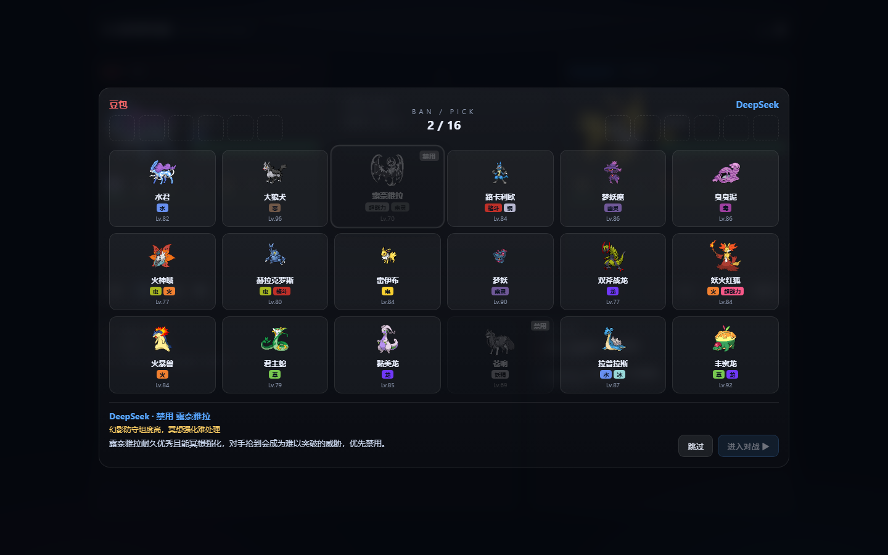

# AI 宝可梦对战（赛博斗蛐蛐）

让不同厂商的大模型各带一支宝可梦队伍对战，全程可观看、可复盘，并带语音解说。



> 个人兴趣项目：用真实 LLM 做逐回合决策，验证「小成本、可观赏、能看出模型差异」的对战形式。与宝可梦官方无关，仅作技术练习，不用于商业用途。

## 特点

- **多模型同场竞技**：DeepSeek、豆包等 OpenAI 兼容接口都能接入，双方各用一个模型
- **完整 Ban/Pick**：各禁 2 只、蛇形选 6 只，池子里可配置传说数量
- **LLM 逐回合决策**：每回合只让场上两家思考，策略差异直接体现在行动和解说里
- **语音解说**：基于 Edge TTS，双方使用不同音色，可静音
- **离线回放**：对战结果写成单个 HTML 文件，双击即可看，带精灵图、血条、行动日志与解说字幕
- **成本可控**：记录每局调用次数与 token 用量，可在命令行直接看到

## 技术架构

```
pokemon-showdown（本地战斗引擎）
        │
        ├── agents/      决策层：llm / heuristic / random
        │     ├── llm.js       OpenAI 兼容接口 + JSON 约束 + 重试
        │     └── heuristic.js 规则兜底
        │
        ├── engine/      对战流程：draft（BP）、battle（回合）、protocol（日志解析）
        ├── render/      回放渲染：player.html + replay.js
        ├── tts/         解说生成与音频合成
        └── lib/         精灵图探测、随机种子、类型表等
```

关键设计取舍记录在 [DESIGN.md](DESIGN.md)：最初想做 12 家 AI 大逃杀，因为调用成本高、并发延迟不可控，最终收敛为「回合制 + 场上两家决策」。

## 快速开始

### 1. 环境

- Node.js 18+
- 能访问所选模型接口与精灵图 CDN

```bash
npm install
```

### 2. 配置模型

复制配置模板，填入自己的 key：

```bash
cp config/llm.json config/llm.local.json
```

```json
{
  "provider": "openai-compatible",
  "baseUrl": "https://api.deepseek.com/v1",
  "apiKey": "你的 key",
  "model": "deepseek-chat"
}
```

也可以在 `profiles` 里配置多个厂商，用 `--p1 llm:deepseek`、`--p2 llm:doubao` 选择。

> `config/llm.local.json` 已在 `.gitignore` 中，不会被提交。也可以改用环境变量 `POKE_LLM_BASE_URL` / `POKE_LLM_API_KEY` / `POKE_LLM_MODEL`。

### 3. 跑一局

```bash
# 两个 LLM 对战
npm run battle -- --p1 llm:deepseek --p2 llm:doubao --turns 40

# LLM 对规则机器人，省 token
npm run battle -- --p1 llm:deepseek --p2 heuristic

# 纯规则对局，不需要任何 key
npm run battle -- --p1 heuristic --p2 random
```

Windows 下也可以直接双击 `一键对战.cmd`。

### 4. 看回放

对战结束后会在 `out/` 生成 `replay-*.html` 和 `replay-*.json`，双击 HTML 即可观看；`打开最新回放.cmd` 会自动打开最新一局。

## 常用参数

| 参数 | 说明 | 默认 |
|---|---|---|
| `--p1` / `--p2` | 玩家类型，`llm:profile` / `heuristic` / `random` | `heuristic` |
| `--p1name` / `--p2name` | 显示名称 | 赤红 / 青绿 |
| `--turns` | 回合上限 | 100 |
| `--pool` | BP 池子大小 | 18 |
| `--bans` | 每方禁用数量 | 2 |
| `--legends` | 池中传说数量上限 | 2 |
| `--no-draft` | 跳过 BP，直接对战 | - |
| `--no-voice` | 不生成语音解说 | - |
| `--bgm` | 内嵌背景音乐文件 | 内置 8-bit |
| `--open` | 结束后自动打开回放 | - |

## 成本说明

一局 20 回合左右的 LLM 对局，大约每方 20 次调用。想严格控制成本可以：

- 减少 `--turns`
- 一方换成 `heuristic`（规则机器人不消耗 token）
- 用便宜模型跑 BP、贵模型跑关键回合

每次运行结束都会打印调用次数与 token 用量。

## 已知限制

- 精灵图依赖 `play.pokemonshowdown.com` 的公开图床，离线时回放只有文字
- 语音解说需要网络（Edge TTS）
- 回放 HTML 内嵌数据，单局约 4 MB
- 没有单元测试，规则机器人策略较粗糙
